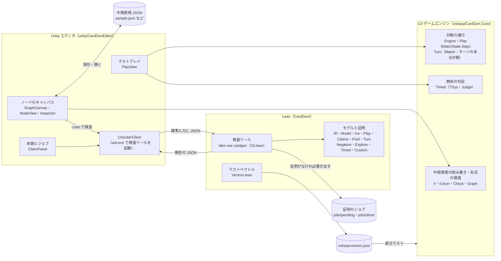
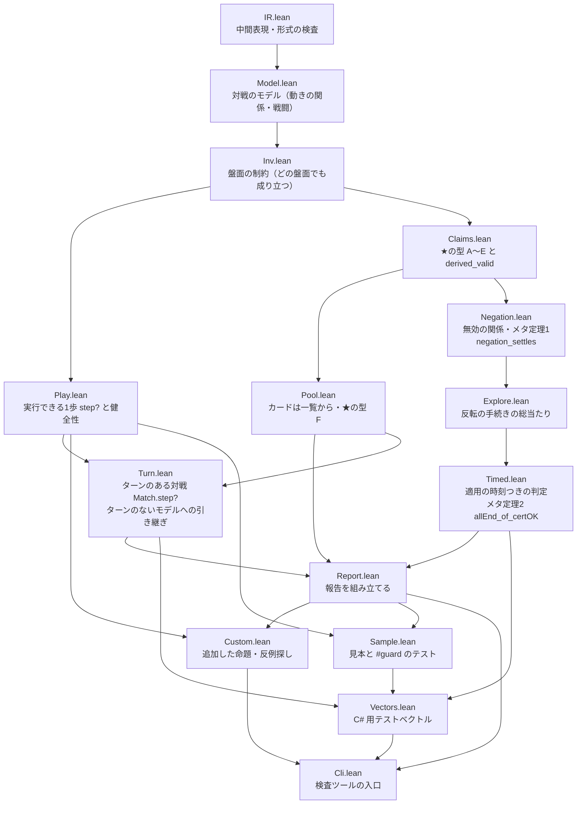
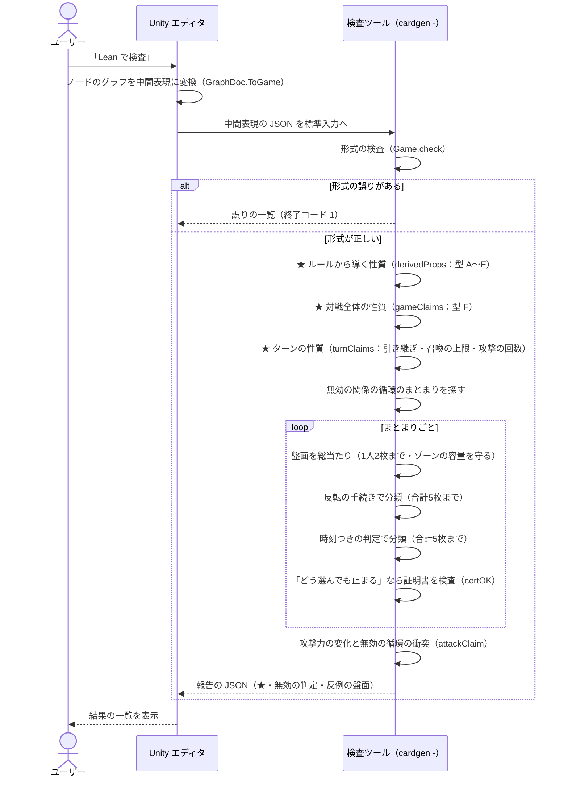
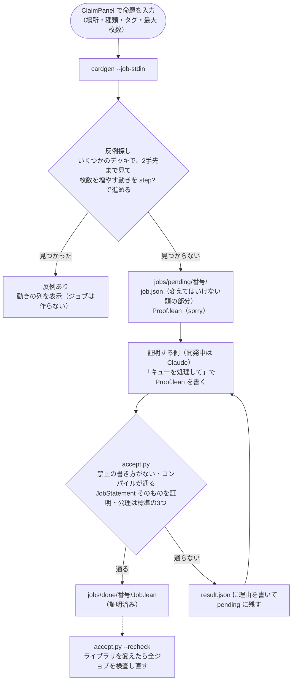
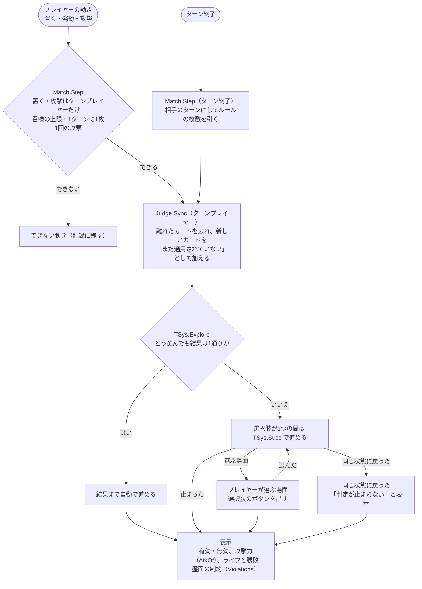
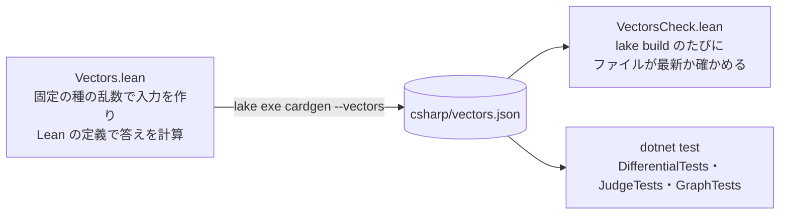

# CardGen のアーキテクチャと処理フロー

2026-10-18 時点の構成。企画の背景は `企画書.md`、中間表現の詳細は `CardGen/中間表現.md`、ジョブの手順は `jobs/README.md`。

## 1. 全体構成

3つの実装（Unity のエディタ、Lean の検査ツール、C# のゲームエンジン）が、同じ中間表現（JSON）を共有する。
Unity は検査ツールを WSL 経由のコマンドとして呼び、C# のエンジンはライブラリとして直接使う。

## 2. Lean のモジュール

矢印は import の向き（下のものが上のものを使う）。証明はすべて `sorry` なし、公理は Lean 標準の3つだけ。

## 3. 「Lean で検査」の流れ

エディタのボタンから、検査ツールが報告（JSON）を返すまで。

報告の命題の状態は次の3つで、「矛盾あり」とは言わない。

| 状態 | 意味 |
|---|---|
| 証明済み | Lean の定理（またはメタ定理と証明書）で保証されている |
| プレイヤーの選択 | 判定は止まるが、選び方で結果が変わる盤面がある |
| 反例あり | 判定が止まらない盤面などが見つかった（その盤面を返す） |

## 4. 命題を追加して証明する流れ

## 5. テストプレイの流れ

動きは C# のターンのある対戦のエンジン（`Match`。Lean の `Match.step?` と差分テスト済み）で進め、
無効の状態は `Judge` が適用された順番を覚えて判定する。

判定の1歩（`TSys.succ`）の規則：

1. 適用中のカードに負けている有効なカードがあれば、それを無効にする。互いに無効にし合う2枚では、先に適用された方が勝つ
2. なければ、有効に戻せるカードを1枚、一番新しい時刻で有効に戻す。何も無効にしないカードを先に戻し、それ以外はターンプレイヤーのカードを先に戻す。同じプレイヤーのカードが複数あれば、そのプレイヤーが選ぶ
3. どちらもなければ止まる

## 6. Lean と C# のずれを防ぐ流れ

照合している項目：範囲の指定、形式の検査（誤りの文章も）、破壊、無効の関係と判定の分類、時刻つきの判定の1歩、攻撃力、
対戦の進行（80試合×50手）、ターンのある対戦の進行（80試合×60手。ターンのルールも対戦ごとに変え、マナとタップも含む）。

## 7. 保証の種類

| 対象 | どう保証するか |
|---|---|
| 盤面の制約（枚数・ゾーン・1マス1枚）、★の型 A〜F | Lean の定理（すべてのルールとカードについて） |
| 循環のない無効の関係 | メタ定理1（`negation_settles`） |
| 循環のある無効の関係 | 総当たり＋証明書（メタ定理2）。小さな盤面だけ |
| 追加した命題 | ジョブごとの Lean の証明（`accept.py` が検査） |
| C# のエンジン | Lean と差分テスト（証明ではない） |
| ターンのある対戦 | ターンのないモデルへの引き継ぎ（`TReachable.of_reachable`）と、召喚の上限・攻撃の回数の定理 |
