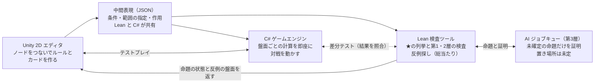

# 検証付きカードゲームジェネレーター企画書

2026-10-17

ユーザーがビジュアルプログラミングでカードゲームのルールとカードを作り、Lean の証明で「どの盤面でも矛盾しない」ことを事前に保証するジェネレーターを、Unity の 2D プロトタイプから作る。

## 目的

ルールやカードを追加したときに、既存のルールや他のカードと衝突して矛盾した状態になるのを、遊ぶ前に見つける。カードゲームではルールとカードの衝突が起きやすく、遊んでから気づくと直すのが難しいためである。

- 前提となる共通ルールは2つに固定する：プレイヤーは自分と相手の2人、相手のフィールドは自分のフィールドを逆さまにした形
- 判定の土台には、遊戯王 OCG のルールを Lean 4 で形式化した yuugi-lean の成果を使う（カード総数の保存、ゾーンの上限、永続効果の判定が止まることの証明、4すくみの解析）

## 全体の仕組み

エディタが出力する中間表現を、Lean の検査ツールと C# のゲームエンジンが共有する。



検査ツールで結論が出ない命題だけが AI に回り、返ってきた証明は Lean のカーネルが検査する。

## ルールの2層とカードの効果

カードの効果は「動きを足すのは自由、盤面の制約は必ず守る」を基準にする。ルールを次の2層に分けると、この線引きを機械的に決められる。

| 層 | 内容 | 例 |
| --- | --- | --- |
| 盤面の制約 | どんな盤面があり得るか | モンスターゾーンにはモンスターだけ、1マス1枚、カードの総数は80枚 |
| 手順の規則 | ゲームが何をどの順で行うか | 初期手札5枚、ドローは1枚、通常召喚は1ターンに1回、手札の上限 |

「破壊されていないモンスターは破壊されない」はどちらの層のルールでもなく、「何もしなければ盤面は変わらない」という前提にすぎない。サンダーボルトは「相手のモンスターをすべて、持ち主の墓地へ送る」という動きを足すだけで、盤面の制約は1つも破らない。

ルールを上書きするカードは、変えるもので次の3種類に分かれる。

- **手順の規則の数値を変える：** 時を裂く魔瞳モルガナイト（ドロー2枚、召喚2回）、無限の手札（手札の上限を外す）
- **カードの種類を変える：** アーティファクト－ロンギヌス①（魔法カード扱いでセット）、D－HERO Bloo－D の装備（装備カード扱い）。OCG は「魔法罠ゾーンには魔法罠だけ」を壊さず、カードの種類を変えることで守っている
- **動きを禁止する：** ロンギヌス③（除外できない）。動きを減らすだけなので盤面の制約は崩れないが、「〜しなければならない」効果と組むと何もできなくなる衝突が起きうる

将来これらを扱うときは、ドロー枚数や召喚回数を「既定値を持ち、永続効果で書き換えられる値」にし、カードの現在の種類を盤面の状態として持つ。

## 検査の3層

カードごとに AI が証明するのではなく、検査器を一度だけ証明し、カードは「データ」として検査する。AI の出番は第3層だけになる。

| 層 | 何をするか | いつ・誰が | 例 |
| --- | --- | --- | --- |
| 1. 部品ごとの証明 | ビジュアルエディタの各ブロックが盤面の制約を守ることを証明する。どう組み合わせても制約は崩れない | ブロックを追加するとき、開発者＋AI | yuugi-lean のカード総数の保存、ゾーンの上限 |
| 2. 判定できる条件 | 組み合わせで決まる性質を、カードのデータに対する検査関数に落とす。検査関数の正しさは一度だけ証明し、カードごとには `decide` で実行するだけ | カードを追加するたび、自動で瞬時 | `simpleReachable_settled`（条件を満たすデッキなら永続効果の判定は必ず止まる） |
| 3. 個別の証明 | 第2層で「判断できない」となったカードを、総当たりか AI の証明で扱う。`sorry` で仕様を先に書き、ジョブキューで証明する | 例外のカードだけ、裏方で | Bloo－D（第2層の条件を満たさない）を含む4すくみ |

第2層の検査は「保証済み」と「判断できない」を返し、「矛盾あり」とは言わない。例えば「無効の関係に奇数長の循環がなければ安定な状態がある」は十分条件にすぎず、4すくみには Bloo－D→ショッカー→スキルドレイン→Bloo－D の3枚の循環があるが、安定な状態はちょうど1つある（`quad_stable`）。

また、安定な状態があることと、判定の手続きが止まることは別の性質である。4すくみでもスキルドレイン側のターンでは、選び方で判定が回り続ける（`quad_someEnd` は「止まる選び方がある」まで）。メタ定理は抽象的な不動点ではなく、適用の時刻と優先規則に沿って進む実際の手続きについて述べる。

## ルールから自動で導く性質（★）

ユーザーの入力はエディタから構造化データで届くので、★は4つの型に当てはめるだけで列挙できる。入力例（初期手札5枚、デッキ40枚、モンスターゾーン×5、魔法罠ゾーン×5、デッキゾーン×1、墓地ゾーン×1）では次のとおり。

| 型 | 規則 | 入力例での★ | 種類 |
| --- | --- | --- | --- |
| A. 初期配置 | 開始時のデッキ枚数 ＝ デッキ枚数 − 初期手札 | 開始時のデッキは35枚 | 開始時の事実 |
| B. 容量 | ある種類のカードの自分のフィールド上の最大数 ＝ その種類を置ける「1枚まで」のゾーンの数 | モンスター最大5体、魔法罠最大5枚、合計最大10枚 | ゲーム中ずっと |
| C. 対称 | フィールド全体の最大数 ＝ 自分の最大数 × 2 | モンスター最大10体、魔法罠最大10枚、合計最大20枚 | ゲーム中ずっと |
| D. 保存 | カードの総数 ＝ デッキ枚数 × 2 | 常に80枚 | ゲーム中ずっと |

列挙に必要なので、ゾーンの定義には次の項目を必ず入力させる。

- 容量の種類：1枚まで（モンスターゾーン、魔法罠ゾーン）か、何枚でも（デッキ、墓地）か。これがないと「最大5体」は導けない
- 「フィールド上」に含めるか：含めないと、墓地のモンスターもフィールドの枚数に数えられてしまう
- 置けるカードの種類

エディタは★ごとに根拠のルールを表示する（例：開始時のデッキ35枚は、初期手札とデッキ枚数の2つから）。開始時の事実は初期状態を計算すれば確かめられる。ゲーム中ずっと成り立つ性質は、第1層の証明に設定値を当てはめて得る。型ごとに一般的な定理を一度だけ証明しておく。

```lean
structure Rules where
  deckSize : Nat
  handSize : Nat
  zones    : List Zone   -- 容量の種類・フィールド上か・置けるカードの種類

def derived (r : Rules) : List Claim := ...   -- A〜D の型を当てはめて★を作る

theorem derived_sound (r : Rules) (r_ok : r.WellFormed) :
    ∀ c ∈ derived r, ∀ g, Reachable r g → c.holds g   -- 一度だけ証明する
```

ルールの数値を書き換えるカードを将来入れたら、その値に依存する★は「既定値のときに限り」の条件付きになる。依存関係を追えば、これも機械的に列挙できる。

## 命題の状態と反例

各命題は次の4つの状態のどれかを持ち、エディタはそれを色分けして見せる。証明より反例の盤面を見せる方が、ユーザーには役に立つ。

| 状態 | 意味 | エディタの表示 |
| --- | --- | --- |
| 証明済み | Lean のカーネルが検査した | 何も出さないか、保証済みの印 |
| 反例あり | 成り立たない盤面が見つかった | その盤面を表示し、どのカードの組み合わせかを示す |
| プレイヤーの選択 | 結果が順序で変わるが、止まる選び方はある | 「ここはプレイヤーが選ぶ」として表示し、エラーにはしない |
| 未確定 | 検査で判断できず、証明も時間内に終わらない | 警告として表示し、保存は許すかを決める |

偽の命題を AI に証明させようとすると時間と費用を無駄にするので、ジョブキューに積む前に必ず反例を探す。

1. 小さな盤面を総当たりで調べる（フィールドの永続効果は十数枚なので現実的）
2. ランダムな対戦を大量に動かす
3. 必要なら SAT ソルバーにかける
4. 反例がなければ、初めて証明のジョブに回す

## 証明したモデルと動くゲームのずれへの対策

プロトタイプでは、共通の中間表現と差分テストでずれを防ぐ。Lean で証明したのは Lean 上のモデルであり、C# で書いたゲームエンジンそのものではないためである。

- **共通の中間表現：** エディタはルールとカードを JSON の小さな言語で出力し、Lean 側と C# 側の両方が同じものを解釈する。中身は「条件」「範囲の指定（種類・属性・陣営・このカード以外）」「作用（破壊・無効・攻撃力変更）」。版 1 の定義は `CardGen/IR.lean`、説明は `CardGen/中間表現.md`
- **差分テスト：** ランダムな盤面を大量に作り、Lean 側と C# 側の結果が一致するか確かめる
- **役割分担：** ある盤面で何が起きるかは C# で即座に計算し、Lean は「どの盤面でも」の保証に集中する
- **将来の選択肢：** 効果の解決部分を Lean で書いてネイティブライブラリにコンパイルし、Unity から呼ぶ。証明したものがそのまま動くが、プロトタイプでは重い

## AI の役割と置き場所

証明は Lean のカーネルが検査するので、どの AI をどこで動かしても正しさは変わらず、選ぶ基準は費用と待ち時間だけになる。置き場所（ローカル、ユーザーの API 契約、自宅サーバー）は後で決めてよい。

- **仕事：** 新しいブロックや検査器のメタ定理の証明、第3層の例外カードの証明、ユーザーが気づいていない性質の提案
- **しない仕事：** ★の列挙（型から機械的に出る）、普通のカードの検査（第2層で済む）
- **証明の受け入れ検査：** `sorry` が残っていないこと、`#print axioms` で余計な公理がないこと、AI が定理の文面を書き換えていないことを機械的に確かめる。`native_decide` を許すかも決める（コンパイラを信頼する公理が増える）
- **速度：** Lean は起動のたびにライブラリを読み込むので、常駐プロセス（Lean REPL）に問い合わせる。yuugi-lean は Mathlib を使わないので、この問題は小さい

## プロトタイプの範囲

プロトタイプでは、盤面の制約を守る動きだけをブロックとして用意する。ルールを上書きするブロックは最初からないので、そういうカードは組み立てられない。検査で弾くのではなく、部品の側で「できないようにする」。

| カード | 何を変えるか | プロトタイプ |
| --- | --- | --- |
| サンダーボルト、ハーピィの羽根帚 | 動きを足すだけ（ゾーンから墓地へ） | 使える |
| スキルドレイン、王宮のお触れ、人造人間－サイコ・ショッカー | 「表側表示で存在する限り、〜の効果を無効にする」永続効果 | 使える |
| アーティファクト－ロンギヌス③ | 動きを禁止する | 後で入れやすい |
| 時を裂く魔瞳モルガナイト、無限の手札 | 手順の規則の数値 | 外す |
| アーティファクト－ロンギヌス①、D－HERO Bloo－D の装備 | カードの種類 | 外す |

エディタの「範囲の指定」ノードは、カードの種類、属性・種族、陣営、このカード以外、の4つから始める。

Lean で証明するメタ定理は2本にする。

1. 無効の関係に循環がなければ、どの順番で適用しても判定は止まり、結果は1通りになる
2. 循環がある場合は、適用の時刻の順番を有限通りに分けて総当たりで調べ、「どう選んでも止まる」「止まる選び方がある」「回り続ける」のどれかを返す。`quad_allEnd_any` の方法を一般化する

テストケースには4すくみ（スキルドレイン、お触れ、ショッカー、Bloo－D の無効の効果）を使う。1本目では「判断できない」、2本目では「プレイヤーの選択」になるのが正解。Bloo－D の装備効果は外すが、無効の効果は使える。

実装の状況（2026-10-18）：

- 1本目は `CardGen.negation_settles` として証明済み。判定の手続きは「安定の条件に合わないカードを1枚選んで有効・無効を反転する」ことの繰り返しとしてモデル化した（OCG の適用の時刻と①②の規則より選び方が自由なので、止まることと結果が1通りであることはより強い主張になる）
- 2本目は、証明ではなく計算による総当たりとして実装した（`CardGen.exploreGroup`）。循環のまとまりの各カードを自分・相手に1枚ずつまで置いた盤面をすべて調べる。4すくみの盤面は「選び方によって回り続ける」となり、yuugi-lean の結論（`quad_someEnd`）と一致する
- 時刻の順番による分類（`quad_allEnd_any` の一般化）は `CardGen/Timed.lean` で実装した。状態に「カードを適用の時刻の古い順に並べた列」を持たせると状態が有限個になり、すべての状態から総当たりできる。「どう選んでも止まる」と判断した盤面は、止まるまでの残りの歩数を付けた証明書を出し、検査が通れば `TSys.allEnd_of_certOK`（メタ定理2）で「どの状態から、どう選んでも止まり、結果は開始時の状態だけで決まる」ことが保証される。4すくみは、Bloo－D 側のターンで「Bloo－D とお触れが有効」の1通りに止まり（`quad_allEnd_any` と一致）、スキルドレイン側のターンでは選び方で回り続ける（`quad_someEnd` と一致）。まとまりの盤面を総当たりすると、yuugi-lean の `loopSrcs`（自分のスキルドレイン・ショッカーと相手のお触れ・Bloo－D）も「どう選んでも止まらない状態がある」として見つかる
- 総当たりの盤面は、各カードを1人2枚まで、ゾーンの容量を守って置けるものに広げた（反転の手続きは合計5枚まで、時刻つきは合計4枚まで）

## 進め方

仕様を先に固め、実装は証明しやすい形を意識して書く。各段階で Lean の定理を先に `sorry` で置き、それを埋める形で進める。

1. **中間表現の設計：** ゾーンの定義（容量の種類、フィールド上か、置けるカードの種類）と、効果のブロック（破壊、無効、範囲の指定）を JSON で決める（済：版 2、`CardGen/`。版 2 でライフと戦闘を追加）
2. **Lean の検査ツール：** ルールとカードの JSON を受け取り、★の一覧と各命題の状態を返すコマンドラインツール（済：`lake exe cardgen`、`CardGen/Cli.lean`）
3. **メタ定理：** ★の型 A〜F の一般的な定理と、無効の関係の2本の定理を証明する（済：`derived_valid`・`gameClaims_valid`、`negation_settles`・`TSys.allEnd_of_certOK`）。型 E は「デッキは増えない」、型 F は「回復のカードがなければライフは初期ライフを超えない」
4. **反例探し：** 小さな盤面の総当たりと、反例の盤面の出力（済：無効の関係の循環について。`CardGen/Explore.lean`・`CardGen/Timed.lean`。追加した命題の反例探しは `CardGen/Custom.lean`）
5. **Unity の 2D エディタ：** ノードをつないでルールとカードを作り、検査ツールを呼んで結果を表示する（済：最初の版。実行時のアプリとして `unity/CardGenEditor`、検査ツールは WSL 経由で呼ぶ）
6. **C# のゲームエンジンと差分テスト：** 同じ中間表現で対戦を動かし、Lean 側と結果を照合する（済：中間表現・形式の検査・範囲の指定・効果の動き・無効の関係・判定の分類・攻撃力・戦闘を含む対戦の進行を `csharp/CardGen.Core` に実装し、Lean のテストベクトルとすべて一致。Unity のテストプレイで使う）
7. **AI のジョブキュー：** 未確定の命題を証明に回す仕組み（済：手動方式。`jobs/`。命題はフィールド上・手札・墓地・デッキの枚数）
8. **戦闘とライフ：** 攻撃力・守備力、攻撃、ダメージ・回復、永続の攻撃力の変化（済：`CardGen/Model.lean` の `State.battle`。盤面の制約の証明と `step?` の健全性を戦闘まで広げた）

## 未決事項

- [ ] AI をどこで動かすか（ローカル、ユーザーの API 契約、自宅サーバー）
- [ ] フィールドのマスの幾何学的な並びをどう表すか
- [ ] 未確定の命題があるカードを、保存や対戦で使えるようにするか
- [ ] `native_decide` を許すか
- [x] yuugi-lean に検査ツールを取り込むか、別のリポジトリにするか（当面は yuugi-lean の `CardGen` ライブラリとして置く）
- [ ] 「〜しなければならない」効果と禁止の効果の衝突をどう検査するか
